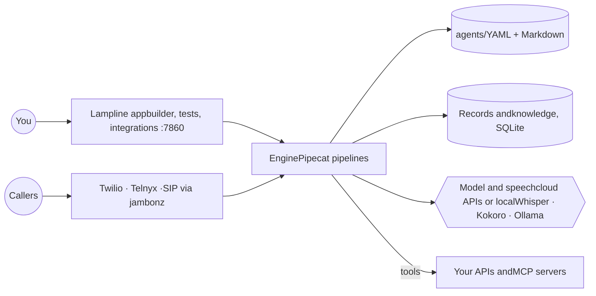

> 本页保存的是公开项目资料快照，阅读过程不需要连接 GitHub。

Open-source, self-hosted voice agents.


  Bring your agents over from Dialogflow CX and CX Agent Studio, or start fresh.
  Build, test and run them on your own machine or servers, in one command,
  for about $0.02–0.17 a call instead of $0.50.


  
  
  
  
  
  


  🚀 Quick start &nbsp;·&nbsp;
  🔁 Import from Google &nbsp;·&nbsp;
  👀 Tour &nbsp;·&nbsp;
  🧠 Models &nbsp;·&nbsp;
  📞 Phone and SIP &nbsp;·&nbsp;
  🗺️ Roadmap &nbsp;·&nbsp;
  📘 Engine docs &nbsp;·&nbsp;
  🧩 vk CLI


  
  


Lampline imports your Dialogflow CX and CX Agent Studio agents, flows, pages,
playbooks, forms and tools included, and runs them on hardware you control. It gives
you a drag-and-drop builder where LLM steps and scripted pages mix in one agent, a test console that lights up each step as the call moves, HTTP and
MCP tools, records and document search of its own, and phone calls over Twilio,
Telnyx or any SIP trunk through jambonz. Built on
Pipecat.


  
    🏠 Local firstOne command on a laptop, a GPU box or an on-prem server. No cloud account needed.
    🔒 Private by defaultNo telemetry, bound to localhost, a key on every request, and keys never in your agents or the repo.
  
  
    🧠 Any modelClaude, OpenAI, Gemini, Vertex AI, Azure OpenAI, Bedrock, Groq, Mistral, DeepSeek, Grok and more, or Ollama on your own hardware.
    🧩 Agents as codeEvery agent is a folder of YAML and Markdown: reviewed in git, tested with vk, exported back to Google's tools whenever you like.
  


## 🔁 Bring your Dialogflow CX and CX Agent Studio agents

Export an agent from Google's console, drop the .zip on **New agent → Import**, and
it opens in the builder: flows, pages, forms, routes, playbooks and tools carried
over, with a report of anything to check before it takes calls. It works the
other way too: **Export** writes any agent back as a Dialogflow CX package or a
CX Agent Studio app.


  
    

  
  

      📥 Import. A Dialogflow CX package or a CX Agent Studio app (JSON or YAML). The conversion runs on your computer and never runs code from the export.
    
    

  
  

      ✏️ Ready to edit. Pages become scripted pages, playbooks become LLM steps, flows group them, and webhooks and OpenAPI tools become tools.
    
  


| From Dialogflow CX | Becomes |
|---|---|
| Flows and pages | Flows of scripted pages: entry messages said word for word |
| Form parameters, entity types | Form fields with their types, choices and synonyms, patterns and keypad input |
| Intent and condition routes, no-match handlers | Transfers the model decides, rules, and "no match" transfers |
| Playbooks | LLM steps with their goal, guidelines and steps |
| Webhooks, OpenAPI tools, data store tools | Tools (webhooks answer with a mock until connected) and local knowledge search |

| From CX Agent Studio | Becomes |
|---|---|
| Root agent and child agents | A root agent with sub-agents and transfers both ways |
| Global instruction, variables | Global instructions and context variables |
| OpenAPI toolsets, Python tools, data stores | HTTP tools, tools with example answers, and local knowledge search |

From the terminal: `vk import auto export.zip` and `vk export dfcx|ces agents/`.
The full mapping, both ways, and what doesn't carry over yet:
cli/README.md.

## 👀 A quick tour


  
    

  
  

      🧪 Test calls. Chat or talk through your microphone. The steps light up as the call moves, and every collected detail shows on the right.
    
    

  
  

      🧠 20 model providers. Pick one, paste a key, press Test connection. Speech runs in the cloud or free on your own computer.
    
  
  
    

  
  

      📞 Phone calls and SIP. Twilio, Telnyx, or your own SIP trunk, PBX or SBC through jambonz. Genesys, Avaya, Cisco and more are coming.
    
    

  
  

      🗄️ Data of its own. Collections agents look up and save during calls, and document search over your FAQs, all on your machine.
    
  


Screenshots use the bundled sample agents and made-up data.

## 🏠 Where it runs

| | Status | |
|---|---|---|
| **Local and on-prem** | ✅ Available | One Docker container, or the engine natively, on any machine you control |
| **Google Cloud** | 🔜 Coming soon | A one-command deployment to your own Google Cloud project |

## 🚀 Quick start

Needs Docker with Compose v2 (Docker Desktop is fine).

```bash
git clone https://github.com/C4rohan/lampline && cd lampline
scripts/docker-up.sh                 # builds the image, starts it, prints the address to open
```

It prints a link like `http://localhost:7860/#/?key=…`: open it once and the
page remembers the key. Pick your model and voice on the Integrations page (or
put keys like `ANTHROPIC_API_KEY`, `GEMINI_API_KEY`, `DEEPGRAM_API_KEY` in
`.env`; see `.env.example`). Your agents are in `./agents` (edit them, keep them
in git) and everything else the engine keeps, settings with your keys, records,
knowledge and downloaded models, is in `./.vpe-data`.
`scripts/docker-up.sh --down` stops it; `--logs` follows its log. Plain
`docker compose up -d --build` works too once `.env` has `VPE_DOCKER_API_KEY`.
Details: engine/README.md.

Prefer no Docker? `scripts/engine-up.sh` runs the engine natively (Python 3.11+)
at http://localhost:7860, which also lets browser calls reach it directly.
Free, private speech: Integrations → Whisper and Kokoro → **Download models**.

## 🧠 Models

Pick one on the Integrations page; each starts on a sensible default model you
can change, and **Test connection** checks the key.

| Provider | Key |
|---|---|
| Claude (Anthropic) | `ANTHROPIC_API_KEY` |
| OpenAI, or any OpenAI-compatible endpoint | `OPENAI_API_KEY`, `VPE_LLM_BASE_URL` |
| Gemini | `GEMINI_API_KEY` |
| Gemini on Vertex AI | `GOOGLE_CLOUD_PROJECT` plus a service account key or this computer's Google credentials |
| Azure OpenAI | `AZURE_OPENAI_API_KEY`, `AZURE_OPENAI_ENDPOINT` |
| Amazon Bedrock | AWS keys, or this computer's AWS credentials |
| Groq, Mistral, DeepSeek, Grok (xAI), Together AI, Fireworks AI, OpenRouter, Cerebras, NVIDIA NIM, Qwen, SambaNova, Nebius, Novita AI | each provider's API key |
| Ollama | none: open models on this computer or your own server |

## 📞 Phone calls and SIP

| | |
|---|---|
| Twilio | a Twilio number rings your agent; outbound calls from triggers |
| Telnyx | the same, through a TeXML application |
| SIP through [jambonz](https://jambonz.org) | any SIP trunk, PBX or session border controller: point a jambonz application at the engine |

The Phone numbers page has the webhook to copy and the steps for each.
Details: engine/README.md.

### 🏢 Contact centers (coming soon)

Genesys Cloud, Avaya, Cisco Webex Contact Center, Cisco UCCE and PCCE, Amazon
Connect, NICE CXone, Five9 and Twilio Flex show on the Integrations page as
coming soon. Until each lands, most of them can already send calls to your
agents over a SIP trunk through jambonz. The plan for each:
docs/ROADMAP.md.

## ⚙️ How it works



The engine reads the agent folders on every call, so a change is live on the
next call. Settings and keys live in a `chmod 600` file outside the repo.

## 💰 What a voice-agent call actually costs

Monthly totals for 4-minute calls at list prices (October 2026). Staff time is
not included. Reproduce or change any assumption with `python3 costs/cost_model.py`.

| Deployment | 10k calls/mo | 50k calls/mo | 200k calls/mo |
|---|---|---|---|
| CX Agent Studio (list price, baseline) | $5,000 | $25,000 | $100,000 |
| On-prem server (no GPU) + Google model APIs | $1,384 | $6,235 | $24,426 |
| On-prem GPU servers + self-hosted models | $681 | $1,363 | $3,748 |
| Cloud Run + Google model APIs (coming soon) | $1,423 | $6,356 | $24,908 |
| GKE production + mixed vendors: Deepgram, Claude Haiku, Fish Audio (coming soon) | $1,105 | $3,612 | $13,037 |
| GKE production + self-hosted models on L4 GPUs, 3-yr CUD (coming soon) | $1,054 | $1,675 | $3,888 |

What the numbers say:
- 📉 **Hosting is the small part.** Model APIs are almost the whole bill, so the model choice matters far more than local vs. cloud.
- 🖥️ **Self-hosted models are where the big savings are,** but they rest on two assumptions nobody has published good data for: concurrent calls per GPU, and whether an 8B open model is good enough for your flows. Help measure them.

Every row, per-call figures and assumptions: costs/COSTS.md.

## 🧩 Agents as code (`vk`)

Build and change agents from a terminal or an AI coding agent as well as the
builder. Each agent is a folder: `agent.yaml` for the graph and one Markdown
file per prompt, so changes are reviewable in git.

```bash
pip install -e cli                  # installs the `vk` command
vk templates install front-desk     # start from a ready-made agent
vk lint agents/front-desk           # graph checks + a scan for real-looking patient data
vk test agents/front-desk           # runs tests/*.yaml conversations on the engine
vk import dfcx export.zip           # bring an agent over from Dialogflow CX or CX Agent Studio
vk skills install --target claude   # builder + reviewer skills for Claude Code
```

Details in cli/README.md. The engine itself, its builder,
tools, data and knowledge: engine/README.md.

## 🗺️ Roadmap

- [x] The engine on Pipecat: builder, text chat, browser calls, phone calls (engine/README.md)
- [x] Agents as code: `vk` lint, conversation tests, templates, coding-agent skills (cli/README.md)
- [x] Scripted pages and flows mixed with LLM steps (engine/README.md)
- [x] Dialogflow CX and CX Agent Studio import and export (cli/README.md)
- [x] Records and local RAG of its own (engine/README.md)
- [x] One Docker container for local and on-prem
- [x] 20 model providers; SIP through jambonz
- [ ] **Google Cloud deployment** (coming soon)
- [ ] **Contact centers:** Genesys Cloud, Avaya, Cisco Webex Contact Center, Cisco UCCE, Amazon Connect, NICE CXone, Five9, Twilio Flex (coming soon)
- [ ] Live-agent transfers, call recordings, published benchmarks

The full list: docs/ROADMAP.md.

## ✅ Tested

CI runs on every push and pull request to `dev`, `qa` and `prod`:
- the `vk` CLI test suite
- the engine test suite: flows, extraction, text chat, every model provider's setup, Twilio, Telnyx and jambonz calls, the voice pipeline and a real WebRTC handshake, on fake models
- the web app builds, and the committed build matches its source
- the Docker image builds, starts as a non-root user, answers health and refuses requests without its key
- shellcheck, and a check that `COSTS.md` matches the cost model
- a scan of every commit for keys and tokens (gitleaks)

Issues and PRs welcome (against `dev`; how dev, qa and prod work). See CONTRIBUTING.md, SECURITY.md, the code of conduct and the changelog.

## 🙌 Credit and citation

Lampline is created and maintained by **Rohan Salvi**. If you use it in a
project, product, paper or talk, please credit "Lampline by Rohan Salvi" and
link this repository. GitHub's **Cite this repository** button (from
CITATION.cff) gives APA and BibTeX:

```bibtex
@software{salvi_lampline_2026,
  author  = {Salvi, Rohan},
  title   = {Lampline: open-source, self-hosted voice agents},
  year    = {2026},
  version = {0.1.0},
  url     = {https://github.com/C4rohan/lampline}
}
```

If you redistribute Lampline or build on it, the Apache-2.0 licence requires
you to keep the NOTICE file, which carries this attribution.

## 📄 License

Apache-2.0. The engine uses Pipecat (BSD-2-Clause), installed from PyPI;
other credits are in NOTICE. Not affiliated with Google or any
provider named here. Prices are list-price estimates that change often; check
them before budgeting.
