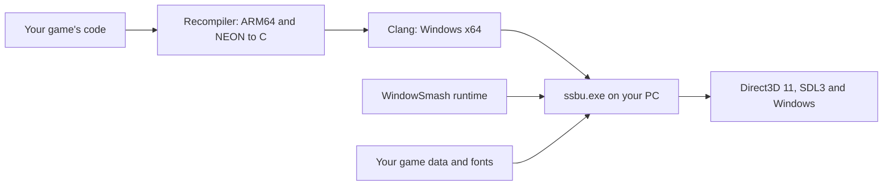

> 本页保存的是公开项目资料快照，阅读过程不需要连接 GitHub。

Super Smash Bros. Ultimate as a native Windows program, built on your own PC from your own copy of the game.


  Setup guide ·
  Playing ·
  Multiplayer ·
  DLC &amp; unlocks ·
  Game updates ·
  Linux ·
  How it works


---

> [!IMPORTANT]
> **This source code does not contain the game.** It has no game files, keys or firmware. You need your own copy of Super Smash Bros. Ultimate, dumped from your own Nintendo Switch. WindowSmash builds a Windows program from that copy, on your PC.

## Contents

- What is WindowSmash?
- What you need
- Install and play
- Controls
- Play with friends
- All guides
- Project status
- How it works
- Getting help
- For developers
- Legal

## What is WindowSmash?

A Nintendo Switch and a Windows PC have different kinds of processors, so a Switch game can't run on a PC as it is. An emulator solves that by translating the game *while you play*. WindowSmash translates it **once, ahead of time**: it turns the game's code into C, compiles that into an ordinary Windows program, and adds a runtime that gives the game what it expects from a Switch: graphics, sound, controllers, files and networking.

The game itself still comes from your files. This repository holds only the translator (the *recompiler*) and the runtime.

**What you get**

- **Up to eight controllers**: Xbox, PlayStation, Switch Pro and most others, plus the keyboard.
- **Windowed, borderless or full screen**, always 16:9, with settings for G-Sync and FreeSync monitors.
- **Online play through Local Wireless**: rooms appear for every player in the online lobby, and nobody has to set up their router.
- **Your DLC fighters**, and a tool that unlocks the base-game roster on your own save.
- **Any game version**, including 13.0.5 with Kazuya and Sora, and several versions side by side.
- **An experimental Linux version**, built from the same source.

## What you need

| | Requirement |
| :--- | :--- |
| **Computer** | A Windows 10 or Windows 11 PC, 64-bit. |
| **Processor** | One with AVX2: an Intel Core i3, i5, i7 or i9 of the 4th generation (2013) or newer, or any AMD Ryzen. Most Pentium and Celeron processors don't have it. |
| **Graphics** | Any graphics card or chip that supports DirectX 11, with an up-to-date driver. |
| **Memory** | 16 GB recommended. |
| **Free space** | About 60 GB on the drive WindowSmash goes on, plus room for your game files (about 17 GB). |
| **Your game files** | Super Smash Bros. Ultimate from your own Switch, with your console's keys and firmware. Any version should work; **11.0.0** and **13.0.5** have been tested. The setup guide lists exactly which files. |
| **Two free tools** | Python and Visual Studio Community. The setup guide shows how to install them. |
| **Time** | About an hour of your own time, plus 30 minutes to a few hours of waiting while your PC builds the game. |

## Install and play

**Follow the setup guide.** It goes step by step, and no programming knowledge is needed: you copy each command from the guide and paste it.

The whole journey at a glance:

| Step | What happens | Your time |
| :---: | :--- | :--- |
| **1** | **Check your PC** can run the game. | 5 minutes |
| **2** | **Gather your game files** into three folders. | 10 minutes |
| **3** | **Install two free tools**, Python and Visual Studio. | 30 minutes, mostly waiting |
| **4** | **Download WindowSmash** and install its helpers. | 5 minutes |
| **5** | **Prepare the game.** Paste a few commands that take what's needed from your files. | 15 minutes |
| **6** | **Build the game.** Paste one command, then wait while your PC translates the game. | 30 minutes to a few hours |
| **7** | **Play.** Double-click `Play SSBU.bat`. | |

Steps 5 and 6 can also run in one go: after downloading WindowSmash, double-click **`Build WindowSmash.bat`** (how).

Start the setup guide →


Already know your way around? The short version


You need Windows 10/11 x64, Python 3.14 as `python`, and Visual Studio 2022 or newer with **Desktop development with C++** and **C++ Clang tools for Windows**. The example paths are your game files in `D:\MyDump`, your keys in `D:\MyKeys` and your firmware in `D:\MyFirmware`.

```powershell
git clone https://github.com/SNO2207/WindowSmash.git
cd WindowSmash
python -m pip install -r requirements.txt
python tools/nca.py exefs "D:\MyDump\program.nca" --keys "D:\MyKeys" --out dump/exefs
Get-ChildItem D:\MyFirmware\*.nca | ForEach-Object { python tools/nca.py romfs-get $_.FullName --keys D:\MyKeys --match .bfttf --flat --out D:\MyDump\fonts 2>$null }
& ".\Configure Game Data.bat"    # asks for your patched, unencrypted romfs.bin and D:\MyDump\fonts
python tools/arc.py nro
python tools/recomp.py all dump/exefs --out build --jobs 16
& ".\Play SSBU.bat"
```

The setup guide's reference section covers DLC, SDL3 for controllers, the audio and video codecs, and the folder layout.


## Controls

Plug in a controller and press a button: each pad becomes the next free player, up to eight. The keyboard plays as player 1.

| Switch button | Keyboard |
| :--- | :--- |
| Left stick | Arrow keys |
| A / B / X / Y | Z / X / C / V |
| L / R | A / S |
| ZL / ZR | Q / W |
| + / − | Enter / Backspace |
| Right stick | I J K L |

| Key | What it does |
| :--- | :--- |
| F1 | Show or hide the overlay (frame rate, online status). |
| F2 | Show more details, including the connected pads. |
| F3 | Take a screenshot (saved in the `screenshots` folder). |
| F11 or Alt+Enter | Switch between a window and full screen. |

> [!NOTE]
> Buttons go by **position**, as on a Switch controller. On an Xbox controller, the right-hand button (**B**) is the Switch's **A**. To use the printed letters instead, or to remap anything, see Playing: controllers. PlayStation, Switch Pro and most other pads need SDL3, which step 12 of the setup guide adds.

## Play with friends

| Way | For | How |
| :--- | :--- | :--- |
| **Online lobby** (the default) | Anyone, anywhere | Double-click `Play SSBU.bat`, open **Local Wireless** in the game, then create a room or pick one from **Rooms List**. |
| **Lobby code** | Friends only, through the online lobby | Everyone adds the same code to `online_server.txt`. Only players with that code see your rooms. |
| **Private room** | A group with one host | The host runs `Host SSBU Netplay.bat`; the others run `Join SSBU Netplay.bat` and type the host's address. |

Everyone needs the **same game version**, and each PC uses its own save. The multiplayer guide walks through each way and what to do when a room doesn't show up.

## All guides

| Guide | Read it to |
| :--- | :--- |
| Setup guide | install WindowSmash and build the game, step by step. |
| Playing | change the controls or the window, and find saves, screenshots and problem reports. |
| Multiplayer | play with other people online or in a private room. |
| DLC and unlocks | use your DLC, or unlock every base-game fighter on your save. |
| Game updates | apply an update file, such as 13.0.5, as a version of its own. |
| Several versions | keep more than one game version and choose one when you start. |
| Linux | build and run the experimental Linux version. |
| Runtime packages | set up a ready-built runtime package with your own game data. |
| How it works | understand the recompiler, the runtime and every tool. |
| Third-party notices | see attributions and licenses. |

## Project status

WindowSmash is **experimental**. Menus and matches run and Local Wireless connects, but much of it hasn't been tested widely yet.

| Area | Where it stands |
| :--- | :--- |
| **Game versions** | Any version should work. **11.0.0** is the most tested. **13.0.5** has been checked through its menus and full roster, its matches less so. Other versions haven't been tried. |
| **CPU and loading** | The game's code is translated to C ahead of time; fighter modules are compiled too and loaded when the game asks for them. |
| **Graphics** | Direct3D 11. Shaders compile the first time each is used, so a new effect can hitch once. `Prepare Shaders.bat` can compile them ahead of time. |
| **Controllers** | Up to eight players on most pads, plus the keyboard. Testing with real pads has been limited so far. |
| **Display** | Windowed, borderless or full screen, kept 16:9, with pacing for fixed-refresh and variable-refresh monitors. |
| **Audio and movies** | Music needs libopus and movies need libvpx, both optional when building. |
| **DLC** | The DLC fighters your version has: 11.0.0 has them up to Pyra/Mythra; Kazuya came with 12.0.0 and Sora with 13.0.0. |
| **Multiplayer** | The online lobby (with direct connections) and private rooms work. Complete matches between two PCs, and the whole roster online, haven't been fully verified. |
| **Linux** | Experimental, cross-compiled from the same source and drawn through DXVK on Vulkan. |

There is no connection to Nintendo's online service, no claim of general Switch compatibility, and no verified performance target.

## How it works



The recompiler finds every function in the game's ARM64 code and writes it out as C. Clang compiles that C for Windows, and it is linked with the runtime, which stands in for the parts of the Switch the game talks to. The game's graphics commands go to Direct3D 11, its shaders are translated to HLSL, and its Local Wireless traffic travels over the internet through a relay.

The **technical guide** explains each part: the CPU model, function discovery, symbol binding, the services, the graphics path, shader compilation, the network protocol, save handling, and every tool in `tools/`.

## Getting help

When something goes wrong, first look at If something goes wrong in the setup guide. To report a problem, open an issue and include:

- the game version, your Windows version, and your graphics card and driver version;
- which WindowSmash you have (the date you downloaded it, or the output of `git rev-parse --short HEAD`);
- what you did, what you expected, and what happened instead;
- after a crash or a freeze, the `.txt` report from the `reports\` folder, and the end of `build\play.log`.

> [!WARNING]
> Logs and reports can contain your folder names, player names and internet addresses. Read them before posting. A crash report's `.dmp` file contains part of the game's memory: share it only privately, with someone who asked for it. Never post game files, keys, saves or generated game code in issues or pull requests.

## For developers

Run the source-only tests. They use made-up data, need no game files, and don't start the game:

```powershell
python -m pip install -r requirements-dev.txt
python -m unittest discover -s tests -v
```

The game-backed instruction and function tests are in the technical guide.

| Folder | Contents |
| :--- | :--- |
| `runtime/` | The native runtime: services, graphics, input, audio, networking. |
| `tools/` | The recompiler, game-file readers, launch helpers and diagnostic tools. |
| `tests/` | Source-only tests. |
| `third_party/` | License texts of third-party code. |
| `docs/` | These guides. |

Everything generated or personal stays out of Git: `build/`, `dump/`, `deps/`, `save/`, version folders such as `v13.0.5/`, caches, captures, reports and local bundles.

## Legal

No project-wide license has been chosen for the WindowSmash source yet; see the third-party notices for the parts that have their own. Super Smash Bros. Ultimate and related names belong to their respective owners. WindowSmash is an independent project and is not affiliated with or endorsed by Nintendo.
